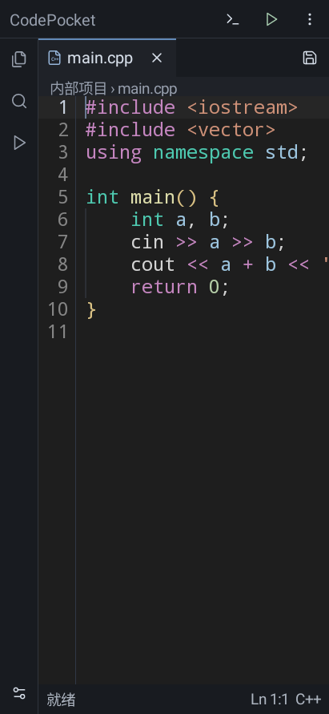
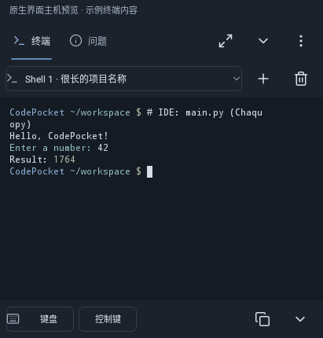
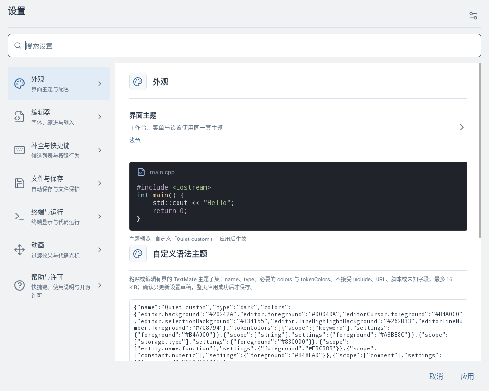
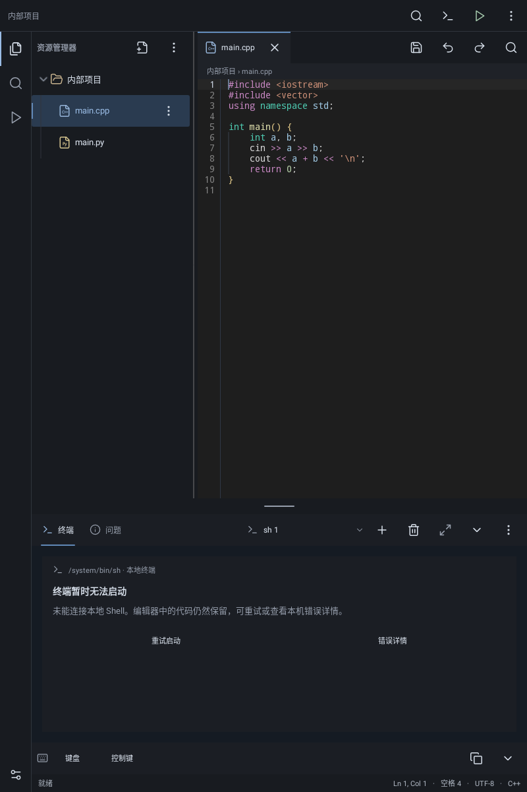
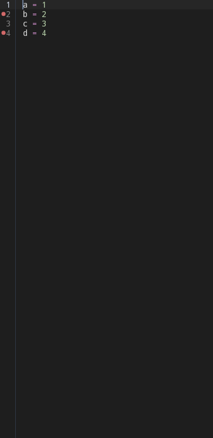
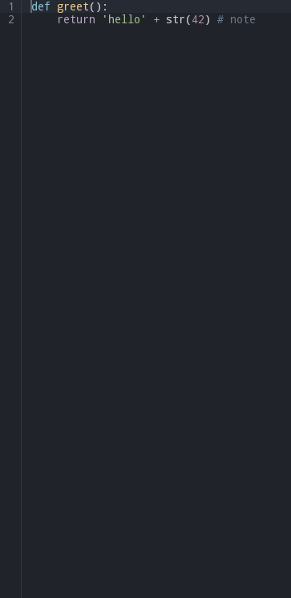
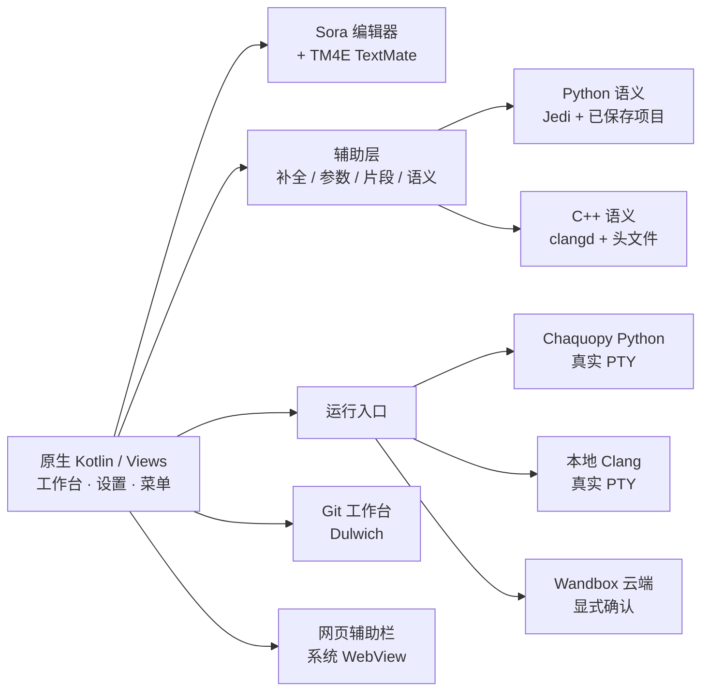

<div align="center">

# 📱 CodePocket

### Android 上的 C++ / Python 学习 IDE

原生 Kotlin · Sora 编辑器 · 真实本地运行 · 真实 PTY 终端

[](https://github.com/juhe291/CodePocket-Android/actions/workflows/build-apk.yml)
[](https://github.com/juhe291/CodePocket-Android/releases/latest)
[](https://github.com/juhe291/CodePocket-Android/releases)
[](https://github.com/juhe291/CodePocket-Android/stargazers)

[](#)
[](#)
[](#)
[](#)
[](#)

### [⬇️ 一键下载 CodePocket 0.2.3 APK](https://github.com/juhe291/CodePocket-Android/releases/download/v0.2.3/CodePocket-0.2.3-arm64-v8a-release.apk)

[Release 页面](https://github.com/juhe291/CodePocket-Android/releases/tag/v0.2.3) · [全部版本](https://github.com/juhe291/CodePocket-Android/releases) · [问题反馈](https://github.com/juhe291/CodePocket-Android/issues)

</div>

<p align="center">
  
  
  
</p>

<p align="center"><sub>截图来自 App 原生渲染（Robolectric 主机截图），不是设计稿；实机显示以设备为准。</sub></p>

---

## ✨ 为什么是 CodePocket？

<table>
<tr>
<td width="50%">

**⚡ 真运行，不是演示**
- Python 3.13 本地进程，接真实 PTY，支持 `input()` 交互
- C++ 支持 **设备本地 Clang**（不联网、可键入输入）或 Wandbox 云端
- Shell、Python、本地 C++ 共用同一个真实终端

</td>
<td width="50%">

**🧠 真分析，不装样子**
- Sora + TM4E 语法着色，Python Jedi / C++ clangd 语义
- 词法补全、参数参考、代码片段、C++ 头文件 Tab 补全
- 语义失败自动降级词法，不猜、不伪造

</td>
</tr>
<tr>
<td>

**🎨 每一处都能调**
- 深/浅/跟随系统，Dark+/Light+，可导入 JSON 的自定义 TextMate 主题
- 代码字号、缩进、补全按键、终端配色、动画与光标
- 分类设置中心，支持多词/别名搜索

</td>
<td>

**🔒 编辑不丢，数据本地**
- 停顿自动保存 + 恢复草稿 + 冲突提示
- 断点按文件持久化，本地 Python 真实 `pdb` 调试
- 不自动上传代码；云端仅在明确确认后发送

</td>
</tr>
</table>

## 🧩 功能地图

| 模块 | 能力 |
| :--- | :--- |
| 📝 **编辑器** | Sora 多标签、文件树、项目搜索、查找替换、跳转行、撤销/重做 |
| ▶️ **运行** | Python 本地交互 · C++ 本地/云端 · 用例批量运行 · 停止 · 退出码/耗时 |
| 💻 **终端** | 真实 `/system/bin/sh`（Termux 组件）、会话管理、面板缩放/最大化 |
| 🐞 **调试** | 点行号栏设断点，F5 后 `p` / `n` / `s` / `c` / `q` |
| 🧠 **智能辅助** | 词法补全、Jedi 语义、clangd 语义、内置参数参考、片段、头文件 Tab |
| 🌿 **Git** | 本地状态/差异/暂存/提交/历史；HTTPS 克隆、获取、快进、推送 |
| 🌐 **网页辅助栏** | 系统 WebView、必应/百度搜索、左右停靠、地址输入可收起 |
| ⚙️ **设置/更新** | 分类搜索、自定义主题、启动自动检测更新 + 手动“检查更新” |

## 🚀 快速开始

1. **下载安装**：[⬇️ CodePocket 0.2.3 APK](https://github.com/juhe291/CodePocket-Android/releases/download/v0.2.3/CodePocket-0.2.3-arm64-v8a-release.apk)（arm64-v8a，Android 7.0+）
2. **覆盖升级**：沿用原 Debug 证书，可直接覆盖旧版，数据保留；重要内容建议先导出
3. **运行第一个程序**：新建 `main.py` 或 `main.cpp` → 点 ▶️ 运行 → 在终端交互
4. **检查更新**：设置根页 → **检查更新**（或 设置 → 帮助与许可 → 检查更新）

<details>
<summary><b>📦 当前版本与校验</b></summary>

- 版本：**0.2.3 (5)**，Release 构建（不可调试）
- 资产：`CodePocket-0.2.3-arm64-v8a-release.apk`
- 大小：**108,820,636 字节**
- SHA-256：`251b2888aae6808e77688c0d5bbba3463172684b257328459487b6fd2a195b30`（GitHub 资产 digest 与本地一致）
- 签名：仓库原有 Debug 证书 `d58e4cd7…`；仅用于本地/学习分发，上架商店需另建发布密钥

</details>

## 🖼️ 更多截图

<p align="center">
  
  
  
</p>

## 🏗️ 架构一览



## 🛠️ 构建与测试

<details>
<summary><b>展开构建命令（JDK 17 / SDK 35 / NDK 27.2 / Gradle 8.9 / Python 3.13）</b></summary>

```powershell
# Debug
./.tools/gradle-8.9/bin/gradle :app:assembleDebug --offline --no-daemon `
  -Pkotlin.compiler.execution.strategy=in-process `
  -Pcodepocket.buildPython="$PWD/.tools/python313-full/tools/python.exe" `
  -Pcodepocket.semanticWheels="$PWD/.tools/semantic-wheels" `
  -I .tools/mirror.init.gradle -I scripts/host-tests.init.gradle

# Release（沿用原 Debug 证书）
./.tools/gradle-8.9/bin/gradle :app:assembleRelease --offline --no-daemon ...（参数同上）

# 测试 + Lint
./.tools/gradle-8.9/bin/gradle :app:testDebugUnitTest :app:lintDebug --offline --no-daemon ...
```

> Windows 非 ASCII 路径下必须加 `-Pkotlin.compiler.execution.strategy=in-process`；仓库自带离线工具与缓存，构建不隐式联网。

</details>

<details>
<summary><b>验证状态与已知边界</b></summary>

- 远端 CI（Linux）：Python/静态分析、Kotlin 1193 + Lint、Shell/片段、APK 构建与签名、包内 Python/语义，最近一次全绿：[run](https://github.com/juhe291/CodePocket-Android/actions/runs/41832515350)
- 本机全量：1193 项中 1191 通过，1 个既有 Windows 头文件大小写夹具失败、1 个旧跳过；Lint 0 error，完整命令真实退出 1，不称全绿
- Android 实机验收（断点、更新网络、主题观感、PTY/IME、本地 C++ 工具链）仍待进行
- P3-D（JavaScript + tree-sitter 等多语言分析）完成调研，尚未实现

</details>

## 📚 文档

- [交接状态与后续计划](docs/RESUME.md)
- [P3 实施计划](docs/P3_IMPLEMENTATION_PLAN_2026-11-02.md)
- [本版交付记录](docs/P3C_BREAKPOINTS_UPDATES_DELIVERY_2026-11-03.md)
- [P3-D 语言分析调研](docs/P3_D_LANGUAGE_RESEARCH_2026-11-03.md)

---

<div align="center">

**如果 CodePocket 对你有帮助，点个 ⭐ Star 支持一下！**

Made with ❤️ for Android + C++ / Python learners

</div>
