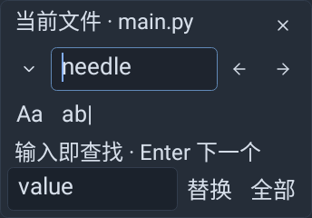
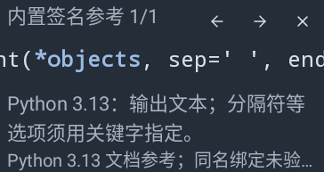
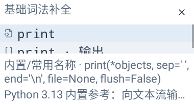
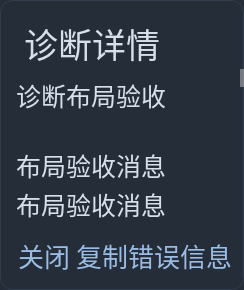

# 主工作台菜单与浮层收尾（2026-10-23）

基线 `639e4e97c6cac5a75e06fbdcade87b6ee7d24406`。保留生产 Kotlin/native Views、同一 Sora、文件/草稿/SAF 和真实运行后端；本批只改主工作台菜单及浮层，没有增加第二个应用或终端。I3 主机范围清单已核对，接下来进入 I4 总验收；不将主机验证等同实机验收。

## 修复与原因

- **空终端菜单分派错误**：结束所有会话后，“新建终端”和“收起运行面板”均使用默认 MenuItem ID 0。自定义菜单按 ID 执行时总会命中第一项，导致收起操作新建终端。为两项分配稳定且不同的 ID，沿用原执行校验。
- **危险操作分组不完整**：旧菜单只在第一个危险项前分隔，后续普通动作仍混在危险组。改为在危险状态或 groupId 变化时分隔，保留顺序、ID、禁用及勾选状态。
- **Esc 退出不可靠**：旧逻辑仅依赖某个菜单行获得焦点后的 KeyUp。滚动容器接管完整 Esc 键对并取得初始键盘焦点，其余方向键继续走原生遍历。
- **参数参考大字体裁切**：固定 20dp 的说明和 44dp 的签名区域容不下放大后的字体。改为实际测量、至少 48dp 的可滚动签名；不足时先隐藏可选描述，仍保留参数形式、控制按钮和内置参考提示，不挤压编辑文本。
- **诊断详情不完整/小窗无响应**：旧浮层仅显示最多六行；空间不足时 Main 忽略 show=false。现在完整消息放入滚动区域；悬浮空间不够时转为可滚动、可选字、可复制的详情窗口；显示前对齐绘制光标。
- **查找替换大字体和标题问题**：固定 56dp 的动作按钮导致文字换行裁切，匹配反馈与选项挤在一行；标题把文件稳定 ID 当作名字。按钮按内容测量、反馈独立伸缩行，主入口显式传当前路径显示文件名。原异步查找、版本校验和单步撤销保持。

跳转行初轮失败另经排查确认是测试未等待 AlertDialog OnShow 消息，过早点击尚未安装验证回调的按钮；已修正测试时序并增加输入错误断言。**未把这个测试夹具问题当作生产 Bug，也没有改写导航/焦点保护。**

## 当前界面清单

延续 [原 UI 总清单](UI_SURFACE_INVENTORY_2026-10-20.md) 和 [可点击设计预览](ui-preview/index.html)，按当前主入口重新核对：

| 范围 / 实际入口 | 当前共用组件及证据 | 本批检查范围 |
| --- | --- | --- |
| 主菜单、编辑操作、项目菜单 | IdeCommandMenu / WorkbenchMenu；UiRedesignTest、MainSurfaceIntegrationTest | ID、危险分组、禁用、Esc、窄窗口；分组菜单实际绘制 |
| 资源管理器、根/子目录、定位/折叠 | ExplorerRow / KeyedViews；WorkbenchViewsTest、WorkbenchWindowIntegrationTest | 原反复收起及选中/创建目标保持；非本批重写 |
| 文件新建、重命名、移动、删除 | nameDialog/askCreate/askRename/askMove/askDelete、WorkbenchStyle | 新建非法名字保留输入及源文件；既有 MainFileSettingsIntegrationTest 覆盖真实磁盘改名/移动/删除/保存失败 |
| 文件重新载入、退出、工作区/最近目录、恢复草稿 | showAnimated + WorkbenchStyle；MainSafRecoveryIntegrationTest / DraftRecoveryTest | 既有真实主机提供方、保存冲突及恢复链重跑；不是所有确认窗口逐一新拍截图 |
| 查找替换 | SearchDialog；EditorFeedbackUiTest、MainSurfaceIntegrationTest | 当前文件名、2倍字体、整次替换与一次撤销、迟到结果保护 |
| 项目搜索、跳转行 | Main.showProjectSearch/showGoToLine | 真 WorkspaceIo 搜索包含未保存缓冲，非法行号保留输入、合法行号 UTF-16 位置准确 |
| 设置及字号 | SettingsDialog / WorkbenchStyle；UiRedesignTest、MainFileSettingsIntegrationTest、WorkbenchWindowIntegrationTest | 七分类/搜索/草稿/取消/异步应用/旋转、大字体、固定底部按钮既有主入口测试重跑 |
| 补全候选、参数参考、片段 | CompletionPopup / SignaturePopup / snippet 菜单 | 真 Main 辅助 worker、光标锚点、2倍字体/浅色平板、实体 Tab 事件接受；片段及组合保护既有回归保留 |
| 终端会话/操作/配色/尺寸/结束确认 | WorkbenchMenu / PanelToolbar / TerminalStatusCard | 空会话收起不新建；原五配色、控制键、键盘、失败日志等既有回归保留；原 Runtime/PTY 未变 |
| 诊断及终端错误详情、快捷键、帮助和许可 | DiagnosticPopup / showDiagnosticDetails / ShellTerminalPane 详情 / SettingsDialog | 完整滚动/复制、极小窗口降级、真实原许可资源保持；未宣称新的语义分析 |
| Android SAF 选择器、输入法、系统文本操作条 | Android 原生机制 | 不替换系统 UI；实机验收统一后置 |

## 实际测试与构建

- 定向 `MainSurfaceIntegrationTest + PopupMotionTest + EditorFeedbackUiTest`：**26/26**，新增主工作台 11 项。初轮失败与修复过程保留在本地 verification 目录；没有删除失败断言或新增跳过。
- 主 App 全量 **644 项：643 通过、1 既有 Windows 符号链接用例跳过**，全部原 633 项状态保持。
- 共享适配器内部 **159/159 沿用缓存**，`:editor-lab:testDebugUnitTest UP-TO-DATE`；本批未修改共享库。没有交付第二份 lab APK。
- `:app:lintDebug` / `:editor-sora:lintDebug`：均 **0 错误**，分别为既有 10 / 1 警告，无新增。主 App 警告为 OldTargetApi1、ChromeOsAbiSupport1、DataExtractionRules1、SetTextI18n7；共享库为固定版本依赖提示。
- 全量 Gradle **BUILD SUCCESSFUL in 2m 3s**，258 任务，19 执行/239 未变化，`:app:packageDebug` 实际执行。
- Python 源码 **44**、实际 APK 字节码 **39**（runner29+diagnostics10）、生成 Shell 的真实 Bash **4**、Python/C++17 g++ 片段各 **7** 均通过。它们是主机执行，不是新增 Android PTY/Chaquopy 设备运行证据。
- APK CRC、路径/重复项、原证书、16KB 对齐、Manifest/权限、DEX/资源/许可证通过；保留 **59** 旧 APK、**921** 非目标 tracked 文件、**28** native/Python 归档、**20** 语法/许可资产、**182** 旧 IDE 顶层类；46 个 vector/137 条 path 与源码一致。实际 DEX 4285 类，测试与 lab Activity 未打包。

证据：`verification/main-app-surfaces-2026-10-23/round2.log`、`after-fix3.log`、`baseline-junit/`、`results.json`、`apk-inspection.json`、`compiled-vectors.json`、签名与执行日志。原 Gradle/Manifest/Actions 生产配置、保存、运行后端和第三方解析器源码保持。

## APK 与源码

[唯一新主 APK](../dist/CodePocket-main-surfaces-2026-10-23-debug.apk)：**26,429,643 字节**，约 25.21 MiB，`com.codepocket.ide` 0.2.0/code2、min24/target34、arm64-v8a，MainActivity 为唯一 launcher。

SHA256：`30395c3a2e7323f1f3fc23309391a9ee5930ca29b62954689763b46fa99e0d30`。

保留原签名证书 SHA256 `d58e4cd7c849ebcf3cf35fde35f1d201c2569bb9ef11f2b48a4ba80cacd10408`，便于覆盖升级。不要卸载旧 App 来解决布局问题，以免丢内部数据。

生产改动：`MainActivity.kt`、`ui/WorkbenchMenu.kt`、`SearchDialog.kt`、`SignaturePopup.kt`、`DiagnosticPopup.kt`、`values/strings.xml`。新增测试 `MainSurfaceIntegrationTest.kt`；更新 README、RESUME、DEVELOPMENT_PROGRESS 和集成计划，并保存下方主机截图。没有依赖升级或真实运行模式变更。

## 视觉与未验证范围

下图来自正常主 Activity 的原生 View 主机绘制。截图为 2 倍系统字号的边界检查，不是模拟运行结果，也不等同完整设备视觉验收；弹窗背景按实际主题色合成，避免只捕获内容导致透明背景误读。

已局部目视上述截图与非法文件名表单；长说明允许有明确的省略/横向滚动，完整诊断可滚动查看/复制。不声称所有二级窗口已逐台设备目视通过。

下一步 **I4 单一主 APK 总验收**：按 I2/I3 清单核对实际默认入口、运行/焦点/文件版本保护、打包运行依赖和 Actions 产物路径，记录未覆盖项，完成后继续原 P2/P3。手机/平板实际 IME、蓝牙键鼠、API24、卓易通及 FPS 统一后置；本批没有新增 Android 真 PTY/Python、远端 Wandbox 或 Actions 运行结果，没有 push/发布。
