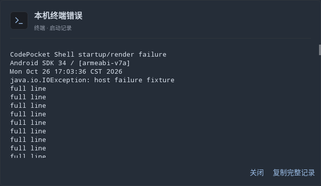
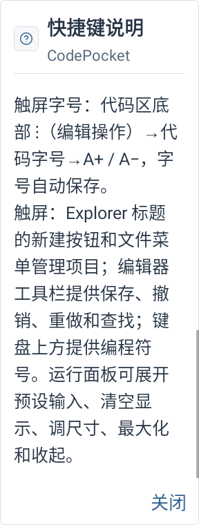
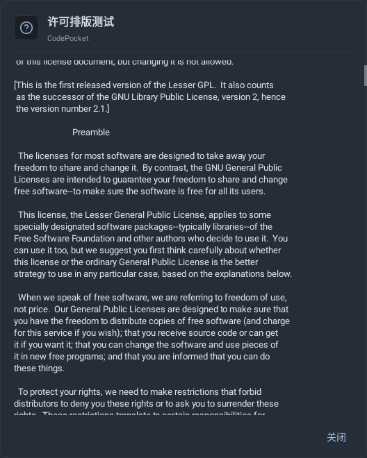
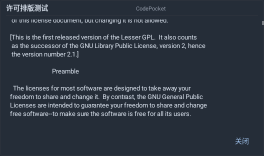
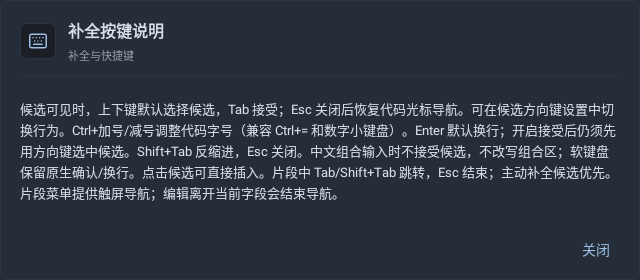
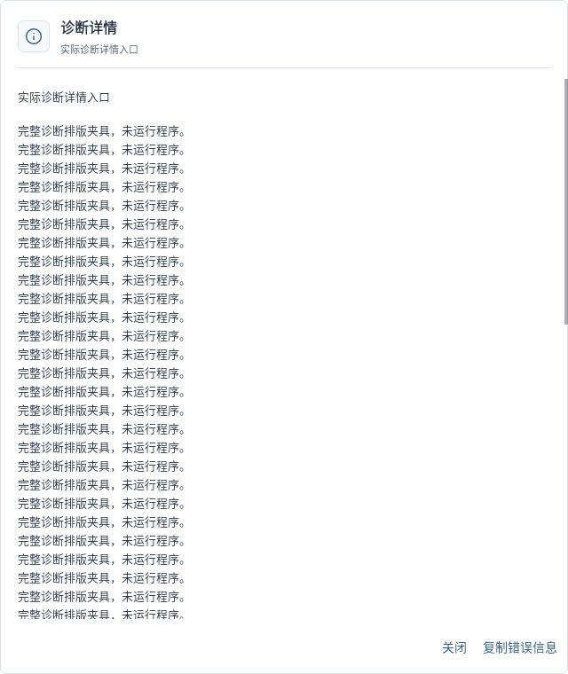
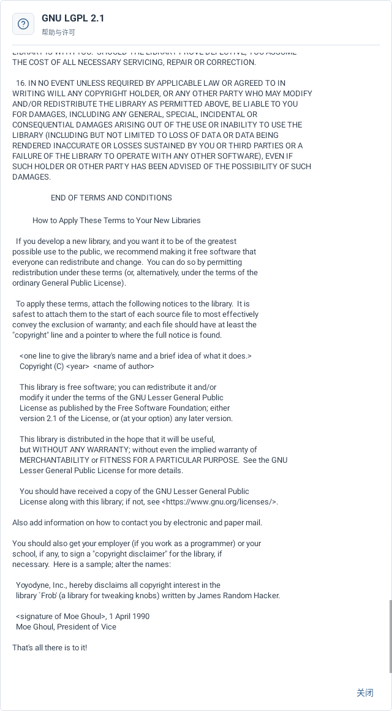

# 只读详情批次原生预览

主机Robolectric原生绘制，来自实际MainActivity/生产Sora、设置、许可资产与终端错误入口。诊断和启动失败长文本为明确标记的布局夹具，未执行设备程序。

已逐张查看本批9张原生图，含手机双倍字体、平板深色按键说明、浅色完整许可末尾、诊断及矮窗终端记录、缩窗和极矮诊断。主机画图不代表实机输入法、键鼠、系统选择菜单或帧率通过。

## compact-terminal-failure-reader

## phone-light-large-shortcuts

## phone-tiny-large-diagnostic-details

## phone-tiny-large-diagnostic-scrolled

## resized-existing-reader

## resized-short-reader

## tablet-key-help-reader

## tablet-light-diagnostic-reader

## tablet-light-license-end

