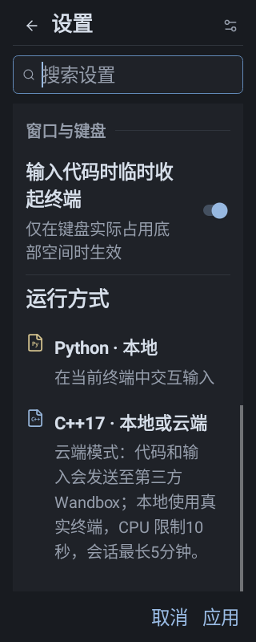
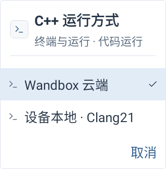
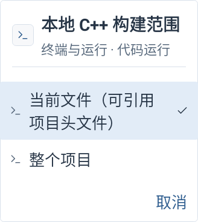
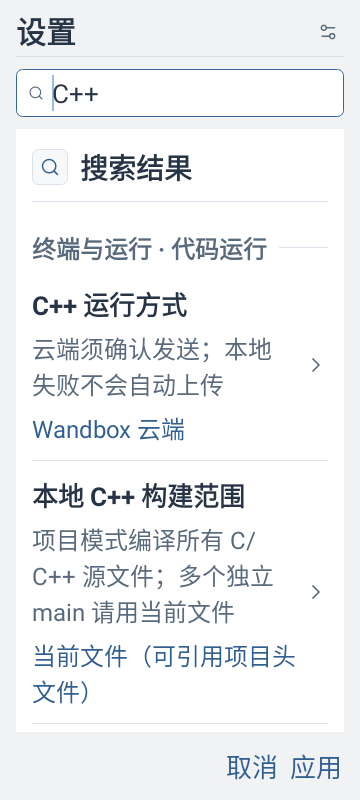
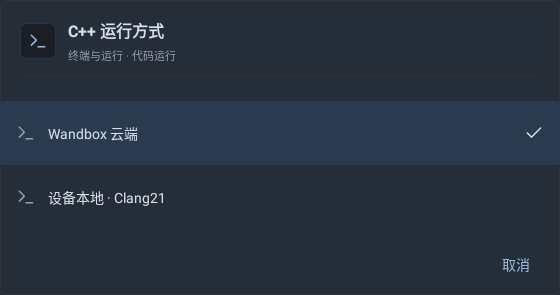
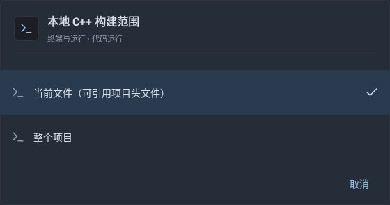
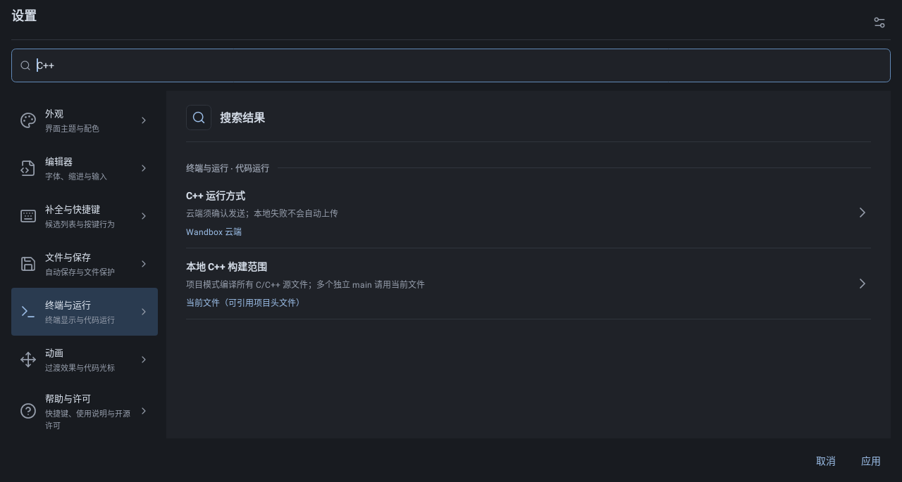

# 本地 C++ 必要设置预览

7 张主机 Robolectric 原生 Views 实际绘制图已查看。覆盖手机浅色/大字体、平板深色、后端/构建范围选项与 320dp 明确上传说明；不代表 Android 实机或运行验收。

## phone-320-large-disclosure

## phone-light-large-backend

## phone-light-large-scope

## phone-light-large-settings

## tablet-dark-backend

## tablet-dark-scope

## tablet-dark-settings

