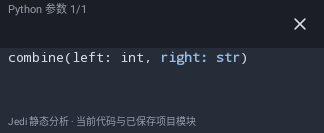
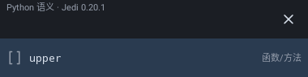

# Python项目上下文原生预览

2026-10-26，三图均已查看。真实Main/Sora与原生Views，用主机Jedi实际输出替代Android IPC；测试逐项校验生产快照正文相同。不是Android设备服务执行证据；布局沿用既有组件，本批不继续零碎UI重做。

候选、真实签名、活动参数和关闭入口可见。设备IME/键鼠/无障碍/性能继续后置；完整结果见[报告](../P2_PYTHON_PROJECT_CONTEXT_2026-10-26.md)。
