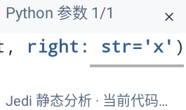
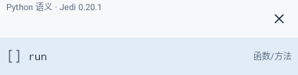
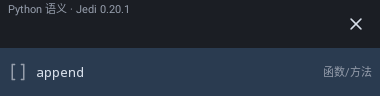

# Python真实补全接入原生预览

已逐张查看以下3图。来自主机实际Main/Sora和真实Jedi响应，主机测试替换Android传输；不是设备进程调用成功的截图。原生窗口样式沿用已有实现，仅来源和实际候选/参数内容变化。

## phone-light-large-real-signature

## tablet-light-project-member

## tablet-real-list-completion

