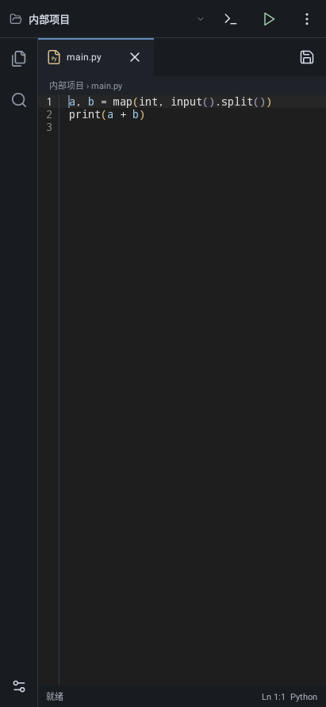
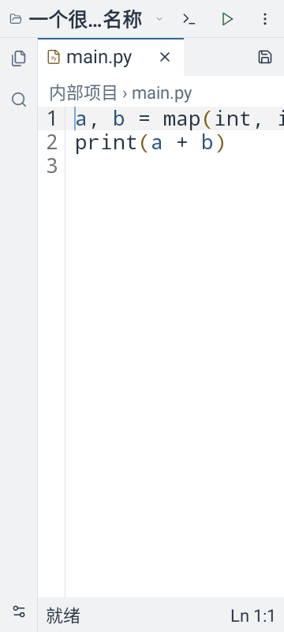
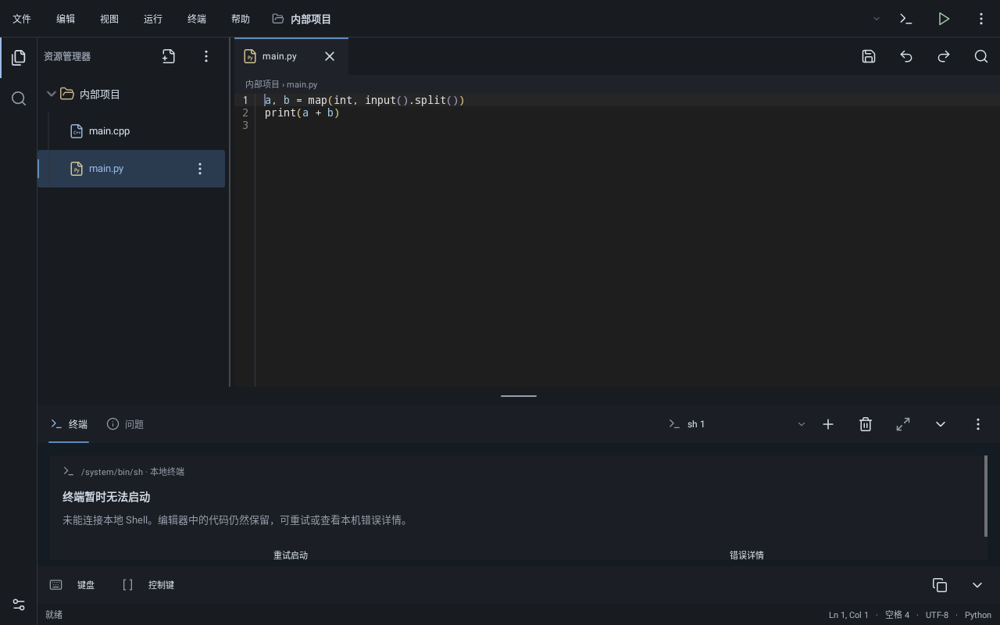
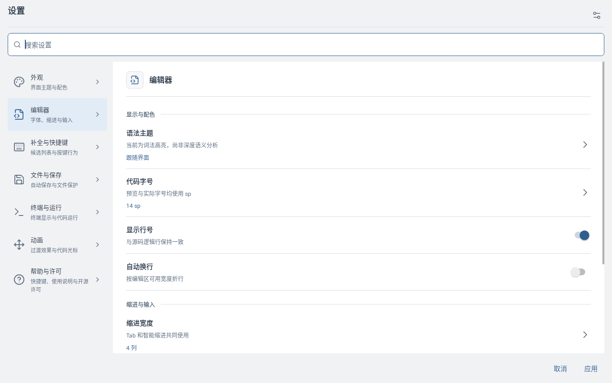
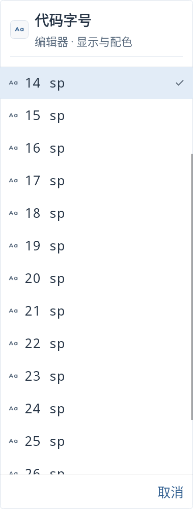
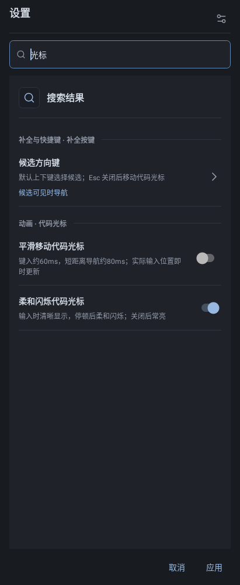
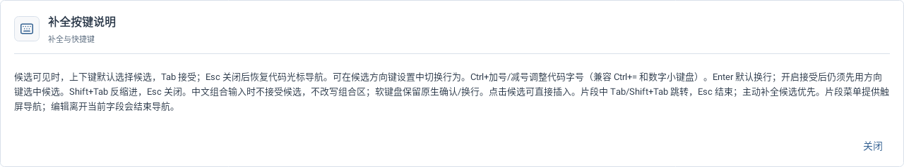

# 主工作台与设置中心原生预览

以下7图由真实 MainActivity/Sora 与 SettingsDialog 的原生 Views 在 Robolectric Native Graphics 绘制，不是设备截图。界面与事务实际回归，不能据此宣称输入法、蓝牙键鼠、卓易通、真实PTY或帧率验收通过。

[批次记录](../UI_SETTINGS_CHROME_BATCH_2026-10-26.md) · [可点击设计样稿](../ui-preview/README.md)

## 手机项目标题与现有工作区入口

## 手机浅色双倍字体长标题，仅排版夹具

## 平板单一运行入口与原工作台

## 平板浅色设置分组

## 手机浅色双倍字体字号选择器

## 手机光标设置搜索与恢复草稿

## 平板按需打开完整补全按键说明

平板说明弹窗阅读跨度偏大已记录，后续与只读详情一起统一宽度；不影响关闭和草稿保护。
