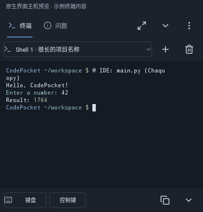
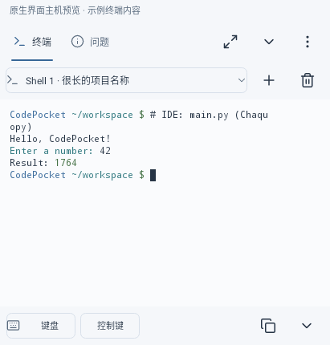
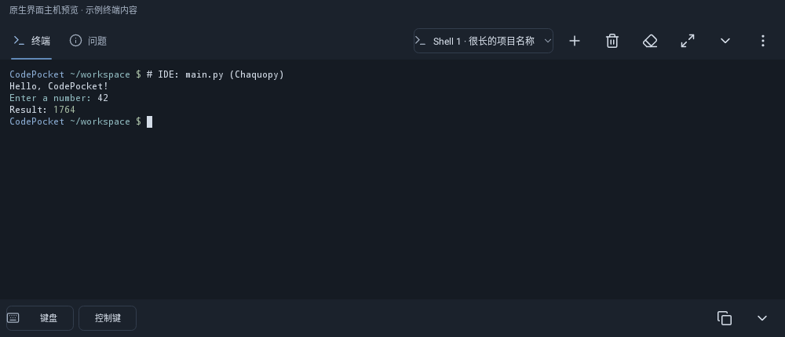
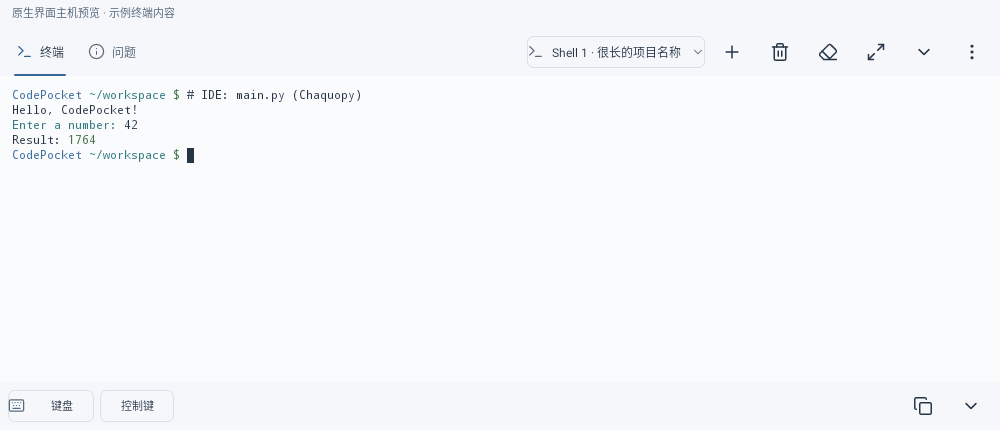

# 终端原生控件预览

以下是生产原生Views和Termux绘制器在Robolectric NATIVE模式生成的主机预览，**不是实机截图**。顶部已标记示例；终端内容由测试注入，用于核对颜色与排版，没有在图中执行Python程序。真实运行模块保持，运行测试及实机边界见[本轮完整记录](../TERMINAL_POLISH_2026-10-20.md)。

手机采用两行标题，会话与操作清楚分组；平板在实际终端宽度允许时合并为一行。紧凑模式会保留直接关闭当前终端的按钮。程序输出本来就允许换行。

## 手机深色

## 手机浅色

## 平板深色

## 平板浅色

